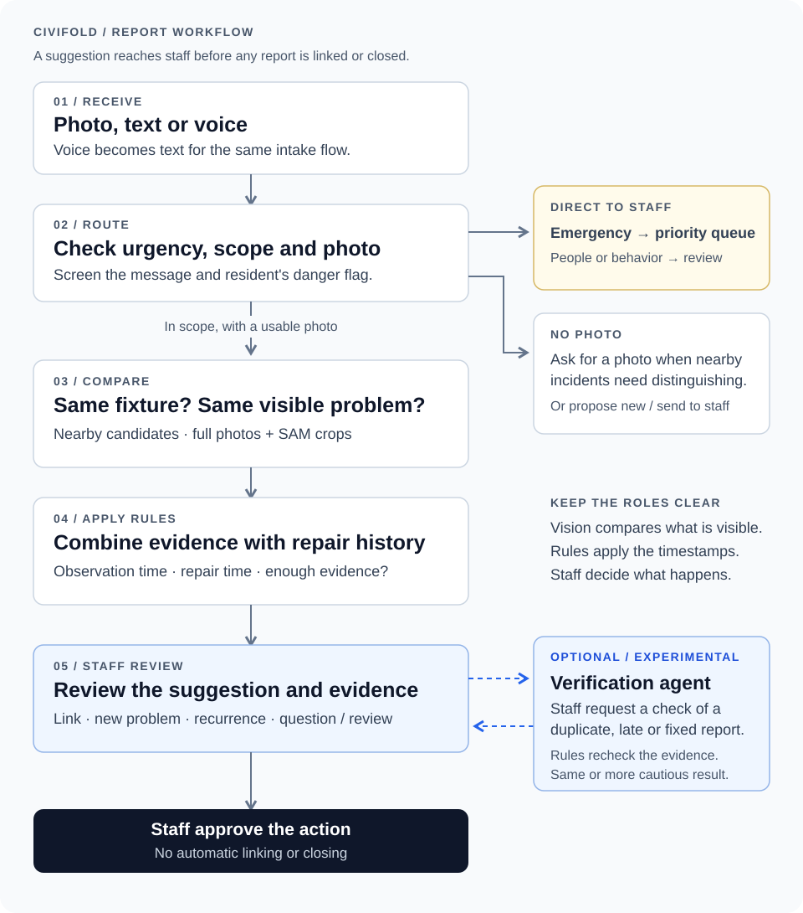

# CiviFold

**Group duplicate reports. Keep recurrences and nearby look-alikes separate.**

CiviFold helps city staff compare photo reports and review the evidence behind each suggestion. Staff approve every link and closure.

**Live demo:** _coming at deployment_ · **3-minute video:** _coming at submission_  
Built for the **Meta Global AI Developer Hackathon · Indie track · Theme: Build for Your World**

In September 2026, New York City's 311 received **3,673 pothole reports**. The Department of Transportation resolved **454 of them (12%) as duplicates** of an earlier report, and **63 as already fixed** when inspected. Someone had to match each of those to the report it repeated.

Residents report a leaking hydrant, a pothole or dumped trash with a photo, text or voice note. The same problem may be reported many times, but proximity alone cannot tell a duplicate from a broken fixture next door, or a problem that returned after repair.

<sub>Source: [NYC Open Data, 311 Service Requests](https://data.cityofnewyork.us/Social-Services/311-Service-Requests-from-2010-to-Present/erm2-nwe9): descriptor "Pothole", created September 1–30, 2026, grouped by resolution description, queried October 29, 2026. Requests still open can change the counts. The data does not show how duplicates were identified or whether any recurrence was merged by mistake.</sub>

## Three reports, three different decisions


| Incoming report | Suggested action | Evidence |
|---|---|---|
| Same leaking hydrant, another angle | **Duplicate** | Matching sign, bike rack and fixture details |
| Similar hydrant, 28 m away | **New problem** | Different shop sign, bollard and doorway |
| Same hydrant, damaged after repair | **Possible recurrence** | Matching location, new damage and a later observation |

## What staff see


Photos side by side, visible differences, the rule behind the suggestion and a map. Staff can accept the suggestion or choose another action. **Nothing is linked or closed automatically.**

*Synthetic sample photos. The white button is the suggested action.*

## Who it is for

These are working assumptions. We have not interviewed city staff or observed their workflow.

- **First user:** the person at a 311 center or public works office who reviews incoming reports before an inspector or crew is sent.
- **What it replaces:** checking a new report against earlier ones by address and description, then opening each candidate to compare. CiviFold places the candidates' photos next to the new one, says what matched and what differed, and pre-selects an action. The reviewer still decides.
- **What it needs from the city:** open and recently repaired incidents with location, category, photos and repair dates. The demo seeds them; a deployment would read them from the existing 311 or work-order system, which is not built. Without repair dates, a late report and a recurrence cannot be told apart.

## From report to decision



**AI reads the photos. Rules apply time and evidence requirements. Staff make the final decision.**

- **Route first.** Emergencies identified from text, voice or the resident's danger flag go to the top of the staff queue. Reports about people or behavior skip image matching. Without a photo, the system requests one when nearby incidents need distinguishing; otherwise it proposes a new incident or sends the report to staff.
- **Compare, then apply time.** Muse Spark compares the full photos and SAM crops. The comparison prompt receives no timestamps. Rules apply the observation time and repair history to distinguish a duplicate, late report or possible recurrence. Insufficient evidence leads to a question or staff review.
- **Verify when staff ask.** For duplicate, late or already-fixed suggestions, an optional agent looks for counter-evidence using the same tools. Its findings can only make the suggestion more cautious. This mode is experimental.

<details>
<summary><strong>Evidence requirements and verification behavior</strong></summary>

Before suggesting duplicate, late or already fixed, the rules require either a confident SAM-crop match or matching evidence from two distinct report photos. An already-fixed suggestion also needs repair evidence in two photos or in a requested close-up.

The verification agent starts with the incident's other photos and similar incidents within 60 m, and can search up to 300 m. Staff can follow its tool calls as they finish. The rules reconsider all returned evidence; the agent cannot make a suggestion less cautious.

- If verification cannot start because no recording or live budget is available, the existing suggestion stays.
- If it stops partway, the rules still use the evidence collected so far.
- Verification uses the latest stored analysis and runs once at a time per report. Results superseded by a staff decision or a newer analysis are recorded without being applied.
- If a candidate incident's repair state has changed since analysis, staff are prompted to analyze again before requesting verification.

</details>

## Built with Meta AI

| Model | Contribution | Used in |
|---|---|---|
| **Muse Spark** | Reads reports and compares visual evidence | Intake & matching |
| **SAM 3.1** | Isolates objects and their surrounding context | Photo comparison |
| **Muse Voice Transcribe** | Converts spoken reports into text | Voice intake |
| **Muse Image** | Generates controlled synthetic scenes | Evaluation dataset |

Muse Spark also powers the **optional verification agent**, which uses function tools to look for evidence against a suggestion.

**Why these models.** The hard part is identity: two residents photograph the same fixture from different angles, in different light, while a look-alike stands down the street. Muse Spark returns that judgment as structured fields the rules can check (same fixture or spot, problem visible, signs of repair, the features that matched), not as a similarity score. SAM 3.1 gives the comparison the object and its surroundings as separate crops, so a dent and a shop sign are both examined. Muse Voice brings spoken reports into the same flow, and Muse Image produced the repairs, recurrences and look-alikes that cannot be photographed on demand.

The crops are not shown to improve accuracy on their own: on holdout2, comparing whole photos only gave more correct suggestions than the deployed fast path (70 vs 66 of 80), with the same critical count (1 / 33). See the [ablations](eval/README.md).

<details>
<summary>Model and dataset details</summary>

Spark uses `muse-spark-1.3`; dataset generation uses `muse-image-1.0`. Muse Image generated 504 evaluation images for about $5. The synthetic scenes cover viewpoint changes, repairs, recurrences and nearby look-alikes.

SAM provides object crops and wider context crops. The comparison retains surrounding landmarks because similar fixtures can be difficult to distinguish from their shape alone.

</details>

## Results

**Latest holdout: 80 reports from 16 assets, including 8 primary fixtures or places and their look-alikes.** Of those reports, 33 describe a new problem or recurrence that must not be dismissed as duplicate, late or already fixed.

All images and resident answers are **simulated**. These are suggestion-level results, not measured staff time savings or evidence of real-world reliability.

| holdout3 · 80 base reports | Distance baseline | **Default: fast path** | Automatic agent¹ |
|---|---|---|---|
| Wrong closing suggestions on reports needing attention | 24 / 33 | **0 / 33** | 0 / 33 |
| Correct suggestions before any resident answer | 26 / 80 | **51 / 80 (63.8%)** | 46 / 80 (57.5%) |
| Correct suggestions after simulated answers | 26 / 80 | **72 / 80 (90%)** | 63 / 80 (78.8%) |
| Deferred to staff without a suggestion | 0 / 80 | **3 / 80** | 12 / 80 |
| Correct duplicate / late links, share of all reports | 22.5% | **42.5%** | 32.5% |
| Reports requiring a resident question | 0% | 28.8% | 28.8% |
| Left to staff if nobody answers | 0% | 31.3% | 37.5% |
| Recorded API spend per report | $0 | $0.053 | $0.053 + $0.025² |
| Time per report, live run | 0 s | 24 s | not comparable² |

¹ `D_hybrid` ran verification automatically on every closing suggestion. These are its corrected second-run results. **They do not measure the app's staff-requested verification mode.** The baseline and fast-path figures are their first and only runs on this holdout.

² The fast path was measured live. The additional $0.025 is the agent's recorded spend in a run that replayed the fast-path calls from cache, so its time does not include them.

**Suggest what is clear, ask about the rest.** Before any resident answer, the fast path got 51 of 80 right and left 25 to staff without a suggestion. It asked one question (a wider shot, another angle, a close-up or the observation time) on 23 reports, and 21 of them ended correct after the simulated answer. Without answers, those reports stay with staff rather than receive a guess.

**Why verification is optional.** On this holdout, automatic verification left the critical count unchanged and increased deferrals from 3 to 12. Across the four evaluation sets, it stopped one wrong suggestion on a stress set. The app therefore defaults to the fast path and offers verification as an experimental staff tool. Returning it to the default would require evidence that its safety benefit justifies the added deferrals, latency and cost.

### How to read the results

- **0 / 33 is an observation, not a guarantee.** Earlier sets had 1–3 critical misses. The denominator is the subset needing attention, not all 80 reports.
- **The baseline is deliberately simple:** it proposes the nearest incident of the same kind as a duplicate. It does not represent any city's actual system.
- **Simulated residents answer correctly** with an unused matching photo or the requested observation time. The no-answer row shows what happens without their replies.
- **Correctly linked is a share of suggestions.** Staff still approve the action; no saving in staff time has been measured.

### Earlier evaluations

Wrong closing suggestions among reports needing attention, using each configuration's first run:

| Set | Assets | Reports | Baseline | Fast path | Automatic agent |
|---|---|---|---|---|---|
| test | 16 | 78 | 24 / 33 | 1 / 33 | 1 / 33 |
| holdout | 8 | 39 | 11 / 16 | 3 / 16 | 3 / 16 |
| holdout2 | 16 | 80 | 22 / 33 | 1 / 33 | 1 / 33 |
| holdout3 | 16 | 80 | 24 / 33 | 0 / 33 | 0 / 33 |

Rules were improved after test and the first holdout, then the fast path was frozen after holdout2. Each holdout was pre-registered before execution. After removing meaningful identifiers from the agent's inputs, we re-measured that configuration on holdout3; both runs remain public.

**[Evaluation methods, harness fixes, ablations and every recorded result →](eval/README.md)**

## Limitations

- **Synthetic evaluation.** No study with real residents or staff, and no measured time savings. The harness supplies correct incident history rather than carrying earlier mistakes into later cases.
- **Four evaluated categories.** Hydrants, street lights, dumped trash and road damage. The app also accepts signs, benches and graffiti, which have not been evaluated.
- **Hard identity cases.** Look-alikes have different surroundings. Identical fixtures sharing the same background have not been evaluated separately.
- **Evidence and uncertainty.** The evidence check counts lines, not semantically independent features. Problem visibility is yes/no; “not observable” is not a separate state.
- **Category disagreement.** Search uses the resident's chosen type, while visual analysis uses the type read from the photo. They can refer to different objects.
- **Changes after analysis.** The out-of-date check compares the candidate incidents an analysis read with their current state. An incident opened nearby after the analysis is not detected.
- **Agent evaluation.** Automatic verification increased deferrals on the latest holdout. Staff-requested verification has no separate evaluation, and single runs do not measure model variance.

Next: same-background look-alikes, an explicit “not observable” state, structured visual evidence and a pilot with real reports.

## Run locally

Requires **Node.js 22.9.0 or later** and a Meta Model API key for model calls from a fresh clone. The local model cache is not included in the repository.

```bash
npm install
cp .env.example .env.local   # add MODEL_API_KEY; empty settings use their defaults
npm run seed                # local PGlite database and demo world
npm run dev                 # http://localhost:3000
```

| Page | Purpose |
|---|---|
| `/demo` | Guided scenarios; reset first, then follow the steps in order |
| `/report` | Resident reporting form |
| `/admin` | Staff queue and evidence review |

`npm test` needs no API key. For evaluation commands, see [the evaluation guide](eval/README.md#running-the-evaluation). Use a new run number to preserve published results.

<details>
<summary><strong>Demo replay and live calls</strong></summary>

The public deployment uses `cached` mode and shows **models: replay**. Guided scenarios replay recorded calls, including a staff-requested agent check in the first scenario. A cache miss never triggers a live call in this mode.

- A report without a prepared result is marked unavailable.
- Verification without a recorded first call does not start; the suggestion stays unchanged.
- If a later call has no recording, verification stops and the rules reconsider the evidence already collected.

Visitors with the demo access code can upload their own photos for live calls, subject to `LIVE_DAILY_USD`.

</details>

**Stack:** Next.js 16 · React 19 · Tailwind 4 · TypeScript · zod · Drizzle · Neon Postgres / local PGlite · Vercel Blob · Leaflet / OpenStreetMap · vitest. Meta calls share caching, retries and cost tracking through `lib/meta/`.

## Built during the hackathon

The code, prompts, synthetic evaluation dataset, generation scripts and evaluation harness were created during **October 26–November 4, 2026**. The first commit is dated October 26 in US Eastern time. No earlier project code is reused; third-party code comes from the open-source dependencies in `package.json`.

The evaluation images and bundled photo demos were generated with Muse Image and are marked **SYNTHETIC** in the app.
