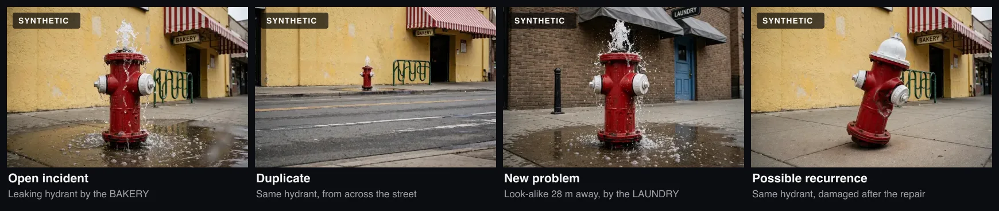
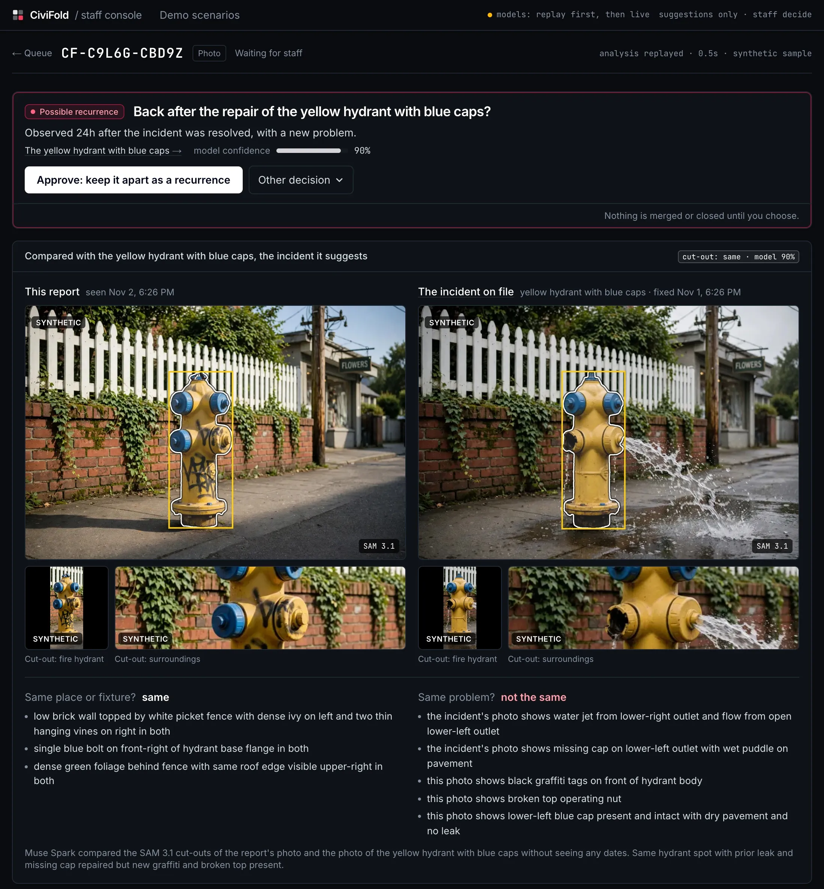
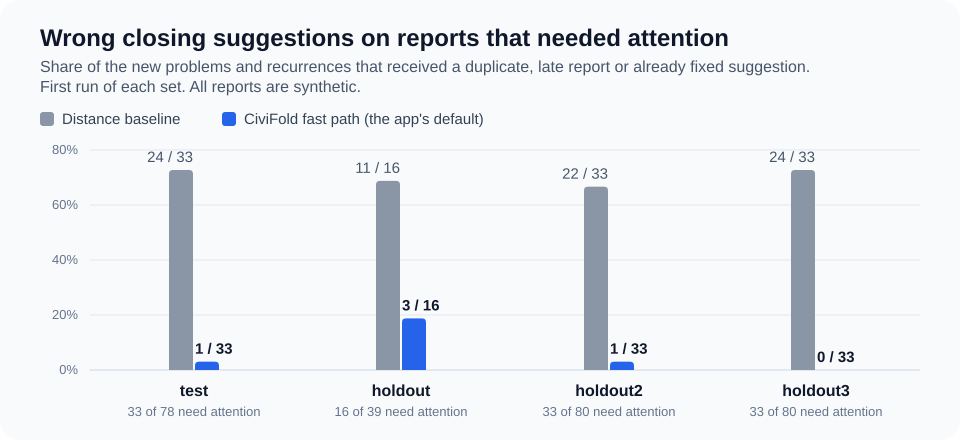

# CiviFold

### Still broken, or broken again? Location can't tell. Photos can.

**[Live demo](https://civi-fold.vercel.app)** · guided scenarios replay recorded model calls, so trying it costs nothing

CiviFold groups duplicate photo reports for city staff and keeps a recurrence, or the look-alike next door, out of the pile. Every link and closure is a suggestion until a staff member approves it.

On a pre-registered holdout of 80 synthetic reports, the fast path made **0 wrong closing suggestions on the 33 reports that needed attention**, in each of two live runs. A location-only baseline made 24 ([results](#results)).

- **Nothing closes by itself.** The system never links or closes a report. It suggests, shows the evidence and waits for staff.
- **Models judge the photo, rules judge the time.** Muse Spark and SAM 3.1 decide whether two photos show the same fixture and the same damage. Rules then apply the observation time and the repair history. The comparison never sees a timestamp.
- **Closing takes two observations.** A duplicate, late report or already fixed suggestion needs a confident cut-out match or two distinct report photos. Staff can ask an agent to look for evidence against it, and the agent can only make the suggestion more cautious.

| Meta model | What it does here |
|---|---|
| **Muse Spark** | Reads the words, compares photos whole and as cut-outs, runs the staff-requested verification agent with function tools |
| **SAM 3.1** | Cuts out the fixture and its surroundings for the comparison |
| **Muse Voice Transcribe** | Turns a spoken report into text |
| **Muse Image** | Generated the 504-image synthetic evaluation set |

**The workload is real.** In September 2026, New York City's 311 recorded 3,662 street pothole requests. The Department of Transportation closed 454 of them (12%) as duplicates of a previously filed complaint, and 63 after an inspection found the problem already fixed ([source](#sources)). A location rule sorts them badly: the broken fixture next door and the problem that returned after repair both sit where the earlier report was filed.

## Three reports, three different decisions



| Incoming report | Suggested action | Evidence |
|---|---|---|
| Same leaking hydrant, another angle | **Duplicate** | Matching sign, bike rack and fixture details |
| Similar hydrant, 28 m away | **New problem** | Different shop sign, bollard and doorway |
| Same hydrant, damaged after repair | **Possible recurrence** | Matching location, new damage and a later observation |

## What staff see



Photos side by side, visible differences, the rule behind the suggestion and a map. Staff can accept the suggestion or choose another action. **Nothing is linked or closed automatically.**

*Synthetic sample photos. The white button is the suggested action.*

## Who it is for

Designed for staff reviewing incoming reports at a 311 center or public works office. NYC's records show that requests are closed as duplicates; they do not establish who makes that decision or when. How such a reviewer works today is an assumption we have not checked with city staff.

- **What changes:** CiviFold puts the candidates' photos beside the new one, says what matched and what differed, and puts the suggested action first. The reviewer still decides.
- **What it needs:** the city's open and recently repaired incidents with photos and repair dates, read from the existing 311 or work-order system (an Open311-style API or an export; not built yet). Without repair dates, a late report and a recurrence cannot be told apart.

## From report to decision

![From report to decision: a photo, text or voice report (voice transcribed by Muse Voice Transcribe) is read by Muse Spark and routed by rules, with emergencies and reports about people going straight to staff; photos go through triage (Muse Spark), a 40 m search (rules), cut-outs (SAM 3.1) and comparison (Muse Spark, no timestamps); rules then suggest duplicate, late report, already fixed, possible recurrence, new problem, one question or staff review, and staff decide. Staff may ask the agent to look for evidence against a closing suggestion.](media/report-flow.svg)

- **Route first.** Emergencies (from the text, the voice note or the resident's danger flag) go to the top of the staff queue. Reports about people or behavior skip image matching. Without a photo, nothing is matched; the system asks for one when nearby incidents need telling apart. That matches how reports arrive: in San Francisco, 7 in 10 of the 311 cases opened in September 2026 came with a photo, and phone calls, 1 in 5, almost never do ([source](#sources)).
- **Compare, then apply time.** Muse Spark compares the full photos and SAM crops without seeing any timestamp. Rules then use the observation time and repair history to tell a duplicate, a late report and a possible recurrence apart. Too little evidence leads to a question or staff review.
- **Verify when staff ask (experimental).** On a duplicate, late or already-fixed suggestion, an agent looks for counter-evidence with the same tools. It can only make the suggestion more cautious.

<details>
<summary><strong>Evidence requirements and verification behavior</strong></summary>

Before suggesting duplicate, late or already fixed, the rules require either a confident SAM-crop match or matching evidence from two distinct report photos. An already-fixed suggestion also needs repair evidence in two photos or in a requested close-up.

The verification agent starts with the incident's other photos and similar incidents within 60 m, and can search up to 300 m. Staff can follow its tool calls as they finish. The rules reconsider all returned evidence; the agent cannot make a suggestion less cautious.

- If verification cannot start because no recording or live budget is available, the existing suggestion stays.
- If it stops partway, the rules still use the evidence collected so far.
- Verification uses the latest stored analysis and runs once at a time per report. Results superseded by a staff decision or a newer analysis are recorded without being applied.
- If a candidate incident's repair state has changed since analysis, staff are prompted to analyze again before requesting verification.

</details>

## Built with Meta AI

**Why these models.** The hard part is identity: two residents photograph the same fixture from different angles, in different light, while a look-alike stands down the street. Muse Spark returns that judgment as structured fields the rules can check (same fixture or spot, problem visible, signs of repair, the features that matched), not as a similarity score. SAM 3.1 gives the comparison the object and its surroundings as separate crops, so a dent and a shop sign are both examined. Muse Voice brings spoken reports into the same flow, and Muse Image produced the repairs, recurrences and look-alikes that cannot be photographed on demand.

The two views catch different mistakes. On holdout2, comparing cut-outs only made no critical error (0 / 33) but got 60 of 80 right; whole photos only got 70 right with one critical error. On that recurrence, the crop-only configuration deferred to staff, avoiding the wrong "already fixed" suggestion made by the whole-photo and combined configurations. The fast path uses both ([ablations](eval/README.md)).

Spark uses `muse-spark-1.3`; Muse Image (`muse-image-1.0`) generated the 504 evaluation images for about $5.

## Results



*Wrong closing suggestions, first run of each set. Rules were improved after test and the first holdout, the fast path was frozen after holdout2, and each holdout was pre-registered before it ran. The automatic agent configuration matched the fast path's count on every set, and a second live run of the fast path on holdout3 also made 0.*

**Latest holdout: 80 reports from 16 assets, including 8 primary fixtures or places and their look-alikes.** Of those reports, 33 describe a new problem or recurrence that must not be dismissed as duplicate, late or already fixed.

All images and resident answers are **simulated**, and the numbers count suggestions, not staff decisions.

| holdout3 · 80 base reports | Distance baseline | **Default: fast path³** | Automatic agent¹ |
|---|---|---|---|
| Wrong closing suggestions on reports needing attention | 24 / 33 | **0 / 33** | 0 / 33 |
| Correct suggestions before any resident answer | 26 / 80 | **51 / 80 (63.8%)** | 46 / 80 (57.5%) |
| Correct suggestions after simulated answers | 26 / 80 | **72 / 80 (90%)** | 63 / 80 (78.8%) |
| Deferred to staff without a suggestion | 0 / 80 | **3 / 80** | 12 / 80 |
| Correct duplicate / late links after simulated answers, share of all reports | 22.5% | **42.5%** | 32.5% |
| Reports requiring a resident question | 0% | 28.8% | 28.8% |
| Left to staff if nobody answers | 0% | 31.3% | 37.5% |
| Recorded API spend per report | $0 | $0.053 | $0.053 + $0.025² |
| Time per report, live run | 0 s | 24 s | not comparable² |

¹ `D_hybrid` ran verification automatically on every closing suggestion (its corrected second run). **It does not measure the app's staff-requested mode.** The baseline and fast path are first and only runs.

² The fast path ran live. D_hybrid replayed the fast-path calls from cache, so only the agent's $0.025 is new and its time is not comparable.

³ First run. A second live run of the same rules and prompts again made 0 / 33 wrong closing suggestions, with 67 / 80 correct and 7 deferred after answers (52 / 80 before any answer). Five of 112 cases moved, all to a more cautious outcome; the stress set was identical. [Both runs are published](eval/README.md#results-base-sets).

**Suggest what is clear, ask about the rest.** Before any resident answer, the fast path got 51 of 80 right and left 25 to staff without a suggestion. It asked one question (a wider shot, another angle, a close-up or the observation time) on 23 reports, and 21 of them ended correct after the simulated answer. Of the 34 correct duplicate and late links, 20 needed no answer. Reports awaiting additional information remain pending; if residents never answer, they are left for staff review.

**Why verification is optional.** On this holdout, automatic verification left the critical count unchanged and increased deferrals from 3 to 12. Across the four evaluation sets, it stopped one wrong suggestion on a stress set. So the app runs the fast path by default and offers verification as an experimental staff tool.

### How to read the results

- **0 / 33 is an observation, not a guarantee.** A second live run repeated it, but earlier sets had 1–3 critical misses. The denominator is the subset needing attention, not all 80 reports.
- **The baseline is deliberately simple:** it proposes the nearest incident of the same kind as a duplicate. It does not represent any city's actual system.
- **Simulated residents always answer correctly**, with an unused matching photo or the observation time. The no-answer row shows the result without them.

<details>
<summary><strong>Earlier evaluation sets</strong> (wrong closing suggestions, first run of each)</summary>

| Set | Assets | Reports | Baseline | Fast path | Automatic agent |
|---|---|---|---|---|---|
| test | 16 | 78 | 24 / 33 | 1 / 33 | 1 / 33 |
| holdout | 8 | 39 | 11 / 16 | 3 / 16 | 3 / 16 |
| holdout2 | 16 | 80 | 22 / 33 | 1 / 33 | 1 / 33 |
| holdout3 | 16 | 80 | 24 / 33 | 0 / 33 | 0 / 33 |

</details>

**[Evaluation methods, harness fixes, ablations and every recorded result →](eval/README.md)**

## Limitations

- **Synthetic evaluation.** No study with real residents, no interviews with city staff, and no measured time savings. The harness supplies correct incident history rather than carrying earlier mistakes into later cases.
- **Four evaluated categories.** Hydrants, street lights, dumped trash and road damage. The app also accepts signs, benches and graffiti, which have not been evaluated.
- **Hard identity cases.** Look-alikes have different surroundings. Identical fixtures sharing the same background have not been evaluated separately.
- **Evidence and uncertainty.** The evidence check counts lines, not semantically independent features. Problem visibility is yes/no; “not observable” is not a separate state.
- **Category disagreement.** Search uses the resident's chosen type, while visual analysis uses the type read from the photo. They can refer to different objects.
- **Changes after analysis.** The out-of-date check compares the candidate incidents an analysis read with their current state. An incident opened nearby after the analysis is not detected.
- **Agent evaluation.** Automatic verification increased deferrals on the latest holdout. Staff-requested verification has no separate evaluation. Only the fast path on holdout3 was run twice; every other configuration and set is a single run.
- **Demo deployment.** The staff console has no login, so anyone with the URL can act as staff, and anyone can reset the demo world (once a minute). A real deployment needs authentication, an audit trail of staff decisions and rate limits.
- **No undo.** Staff decisions are final: a link cannot be undone and an incident cannot be reopened. The analysis starts from the resident's tracking page; a report whose page was never opened waits in the staff queue as not checked yet.

Next: same-background look-alikes, an explicit “not observable” state, structured visual evidence and a pilot with real reports.

## Run locally

Requires **Node.js 22.9.0 or later** and a Meta Model API key for model calls from a fresh clone. The local model cache is not included in the repository.

```bash
npm install
cp .env.example .env.local   # add MODEL_API_KEY; empty settings use their defaults
npm run seed                # local PGlite database and demo world
npm run dev                 # http://localhost:3000
```

| Page | Purpose |
|---|---|
| `/demo` | Guided scenarios; run the steps in order |
| `/report` | Resident reporting form |
| `/admin` | Staff queue and evidence review |

`npm run lint`, `npm run typecheck` and `npm test` need no API key; CI runs the three on every push. For evaluation commands, see [the evaluation guide](eval/README.md#running-the-evaluation). Use a new run number to preserve published results.

<details>
<summary><strong>Demo replay and live calls</strong></summary>

The public deployment uses `cached` mode and shows **models: replay**. Guided scenarios replay recorded calls, including a staff-requested agent check in the first scenario. A cache miss never triggers a live call in this mode.

- A report without a prepared result is marked unavailable. A typed message sent with a sample photo has no recorded reading: the photo is then analyzed alone, and the resident and staff are both told that the words were not read.
- Verification without a recorded first call does not start; the suggestion stays unchanged.
- If a later call has no recording, verification stops and the rules reconsider the evidence already collected.

Visitors with the demo access code can upload their own photos for live calls, subject to `LIVE_DAILY_USD`.

</details>

**Stack:** Next.js 16 · React 19 · Tailwind 4 · TypeScript · zod · Drizzle · Neon Postgres / local PGlite · Vercel Blob · Leaflet / OpenStreetMap · vitest. Meta calls share caching, retries and cost tracking through `lib/meta/`.

## Built during the hackathon

An entry in the Meta Global AI Developer Hackathon, Indie track, theme "Build for Your World". The code, prompts, synthetic evaluation dataset, generation scripts and evaluation harness were created during **October 26–November 4, 2026**. The first commit is dated October 26 in US Eastern time. No earlier project code is reused; third-party code comes from the open-source dependencies in `package.json`.

The evaluation images and bundled photo demos were generated with Muse Image and are marked **SYNTHETIC** in the app.

## Sources

- **NYC 311 pothole figures.** [NYC Open Data, 311 Service Requests](https://data.cityofnewyork.us/Social-Services/311-Service-Requests-from-2010-to-Present/erm2-nwe9): complaint type "Street Condition", descriptor "Pothole", created September 1–30, 2026, grouped by resolution description, queried October 29, 2026. Highway potholes (185 requests, a separate descriptor) and bridge potholes (11) are excluded. Open requests can still change the counts. The channel field reads UNKNOWN for all of these requests and the dataset has no photo field, so it does not show how many came with a photo, how duplicates were identified, or whether any recurrence was merged by mistake.
- **San Francisco 311 channels.** [DataSF, 311 Cases](https://data.sfgov.org/City-Infrastructure/311-Cases/vw6y-z8j6): cases with `requested_datetime` in September 1–30, 2026, grouped by `source`, counting cases whose `media_url` is set, queried October 29, 2026. Of 76,457 cases, 69% carried an attachment (mobile 84%, web 89%, phone 0.2%); phone was 19% of cases. An attachment is usually a photo but the field does not say. NYC's dataset has no attachment field.
- **Evaluation numbers.** [eval/README.md](eval/README.md) and the JSON files in [eval/results/](eval/results/), each with the code and prompt fingerprints it ran with.
