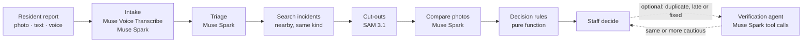

# CiviFold

**CiviFold helps city staff group duplicate reports while flagging possible recurrences and nearby look-alike assets. Every grouping is a suggestion; staff make the final decision.**

Live demo: _added at deployment_ · Video (3 min): _added at submission_ · Built for the Meta Global AI Developer Hackathon (Indie track)

Residents report a leaking hydrant, a broken street light, a pothole or dumped trash with a photo, a message or a voice note. The same problem is often reported many times. Merging reports by location alone is easy, but that is also how a problem gets buried. The hydrant two doors down looks identical, and a pothole that came back after a repair sits at the same coordinates as the one that was fixed. CiviFold compares what the photos show and gives staff the compared photos and the reason for each suggestion.

## Three scenes


| What arrives | What CiviFold suggests | Why |
|---|---|---|
| The leaking hydrant by the BAKERY, photographed from across the street | **Duplicate** of the open incident, one click to link | The shop sign, the bike rack and the hydrant itself match in the whole photo and in the SAM cut-out |
| The same hydrant model with the same broken cap, 28 m away by the LAUNDRY | **New problem**. The nearby incident is shown as ruled out, with the differences | Different sign, bollard and door. A distance rule would have merged it |
| The repaired hydrant, now leaning and dented | **Possible recurrence**, for staff to open a linked recurrence incident | Same hydrant, observed after the recorded repair, with a new problem |

In the staff console, each suggestion comes with the photos side by side, what the model saw in them ("BAKERY sign text visible in both"), the rule that decided, a map, and, when staff ask for it, the verification agent's tool calls. The suggested action is one button among the others. Nothing is merged or closed until staff choose.


*Staff review a possible recurrence: the new photo, the incident's photo from before the repair, the rule that decided, and the actions. The suggested one is white; nothing happens until staff choose. Synthetic sample photos.*

## From report to decision



- **Emergencies and out-of-scope reports.** Possible emergencies are recognized from the message, the voice transcript, or the resident's "someone may be in danger" tick, not from the photo. They skip matching and go to the top of the staff queue. Reports about people or behavior go straight to staff.
- **Reports without a photo.** Without a photo, CiviFold does not propose a match. It asks for a photo when nearby incidents need to be distinguished. Otherwise it proposes a new incident for staff review.
- **Seeing and timing are kept apart.** The models judge only what the photos show: same fixture or spot, problem visible, signs of repair. The comparison prompt never sees a timestamp. Time (before or after the recorded repair) is applied by deterministic rules. That is how a "same place" verdict becomes a late report, already fixed or a possible recurrence, for a reason staff can read.
- **Evidence before a closing suggestion.** Before suggesting duplicate, late or already fixed, the rules require either a confident SAM-crop match or matching evidence from two distinct report photos. "Already fixed" also needs the fix to show in two photos, or in the close-up the system asked for. When that is missing, the resident is asked one question (a wider shot, another angle, a close-up), or the report goes to staff.
- **The verification agent (optional, experimental).** On a duplicate, late or already-fixed suggestion, staff can ask the agent to check it. It uses the same tools as the pipeline to look for evidence against the suggestion: the incident's other photos, and look-alikes within 60 m. The rules then decide again on everything it found, and the most cautious answer stands. It can stop a suggestion but cannot make one less cautious. Staff see each check as it runs, then one of three results: confirmed, evidence against (with the comparisons that went against it), or not settled. A suggestion made before an incident it relied on changed (a repair recorded since) is marked out of date, and staff run the fast path again instead of the agent.
  - If it cannot start (nothing recorded to replay in the public demo, or no budget for live calls), the suggestion stays as it is.
  - If it stops partway, what it found so far still goes through the rules.
  - It checks the latest stored analysis, one run per report at a time. A result that arrives after the report changed (a staff decision or a newer analysis) is kept on record but not applied.

## What the Meta models do

| Model | Role | Why it is needed |
|---|---|---|
| **Muse Spark** (`muse-spark-1.3`) | Reads each photo (fixture, problem, photo quality), compares a new photo with an incident's photos, and, when staff ask, runs the verification agent with function calling | Uses visible landmarks and fixture details to distinguish nearby reports |
| **SAM 3.1** | Cuts out the fixture or spot, plus a wider crop of its surroundings | Lets the comparison look at the object's own details (a dent, a crack) and at its immediate context separately. Context is evidence too: on its own, the cut-out would make two identical hydrants indistinguishable |
| **Muse Image** (`muse-image-1.0`) | Generated the evaluation dataset: 504 images, about $5 | Synthetic images let us control viewpoint changes, repairs, recurrences and nearby look-alikes |
| **Muse Voice Transcribe** | Turns a voice report into text | Voice reports enter the same intake flow as written ones |

## Results

The newest holdout has 16 assets: 8 fixtures or places, each with a look-alike. It was not used in development. The baseline and fast-path columns are their first and only runs. The last column is an earlier configuration that ran the agent automatically on every closing suggestion, in its corrected re-run (see below). It has 80 base reports. 33 of them need attention: a new problem or a recurrence that must not be closed as a duplicate, a late report or already fixed.

| holdout3, 80 base reports | Distance baseline | **CiviFold as deployed** (fast path) | Fast path + agent run automatically (D_hybrid) |
|---|---|---|---|
| Wrong "duplicate / late / fixed" suggestions on the 33 reports that need attention | 24 / 33 | **0 / 33** | 0 / 33 |
| Correct suggestion, after simulated resident answers | 26 / 80 | **72 / 80 (90%)** | 63 / 80 (78.8%) |
| Left to staff without a suggestion | 0 / 80 | **3 / 80** | 12 / 80 |
| Reports correctly linked as a duplicate or late report, share of all reports | 22.5% | **42.5%** | 32.5% |
| Asked the resident one question | 0% | 28.8% | 28.8% |
| Left to staff if no resident ever answers | 0% | 31.3% | 37.5% |
| Recorded API spend per report | $0 | $0.053 | $0.053 + $0.025 ¹ |

¹ The fast-path figure is its live run. The $0.025 is the agent's additional spend in the D_hybrid run, whose fast-path calls were replayed from the fast path's cache.

What these numbers are and are not:
- They count **suggestions**. Nothing is deleted or merged without staff.
- The 33 are the subset that needs attention, not all 80.
- The distance baseline suggests the nearest incident of the same kind as a duplicate. It is a simple reference point, not a model of any city's actual system.
- 0 / 33 is what was observed on this set, not a guarantee that a recurrence is never missed. Earlier sets had 1 to 3 misses (below).
- The images and the resident answers are simulated: a resident asked a question always answers with a matching, unused dataset photo.
- "Correctly linked" is a share of suggestions, not a measured saving of staff time.

**All evaluation sets** (wrong closing suggestions on the reports that need attention, first run of each set):

| Set | Assets | Base reports | Distance baseline | Fast path (deployed) | Fast path + automatic agent |
|---|---|---|---|---|---|
| test | 16 | 78 | 24 / 33 | 1 / 33 | 1 / 33 |
| holdout | 8 | 39 | 11 / 16 | 3 / 16 | 3 / 16 |
| holdout2 | 16 | 80 | 22 / 33 | 1 / 33 | 1 / 33 |
| holdout3 | 16 | 80 | 24 / 33 | 0 / 33 | 0 / 33 |

The rules were improved after the test run and again after the first holdout, each time from their failures. Each holdout was pre-registered (its cases and the code and prompt fingerprints recorded) before it ran. After holdout2 the fast path was frozen, and the last round changed only the verification agent. The evaluation notes have the per-configuration comparison, the stress sets (night, blur, low resolution, GPS error), the re-measurements and every raw result: [eval/README.md](eval/README.md).

After removing meaningful identifiers from the agent's inputs, we re-evaluated the same holdout. The corrected run did not reduce critical errors and increased deferrals; both runs are reported in the evaluation notes.

**Why the agent is optional.** Run automatically on every closing suggestion (D_hybrid), the agent never reduced critical errors on holdout3 and sent more reports to staff (12 against 3). Across all four unseen sets it stopped one wrong suggestion, on a stress set. So the app runs the fast path alone, and keeps the agent as an experimental check that staff request on a suggestion; it shows Muse Spark verifying with the pipeline's own tools, and it can only make a suggestion more cautious. It would return to the default path only if an unseen set showed it stopping wrong suggestions the fast path makes. The staff-requested mode has not been evaluated separately: the D_hybrid numbers measure the automatic configuration.

## Limitations

- **Evaluation scope.** The evaluation used synthetic images and simulated resident answers. There has been no study with real residents or staff, and no measured saving in staff time.
- **Evaluated categories.** The app accepts hydrants, street lights, signs, benches, road damage, trash and graffiti. The dataset covers four of them: fire hydrants, street lights, dumped trash and road damage.
- **Hard identity cases.** Look-alikes in the dataset stand in different surroundings. Two identical fixtures in front of the same shop, sharing the same background, have not been evaluated separately.
- **Evidence checking.** A "same" verdict needs at least two distinguishing observations, but the check counts the model's evidence lines. It does not verify that they are semantically independent features.
- **Observation uncertainty.** Whether a problem is visible is a yes/no field. "Cannot be seen" (too far, hidden) is handled indirectly, through photo quality, repair signs and the follow-up questions, not as its own state.
- **What is analyzed.** Incident search uses the kind the resident picked. The cut-out and comparison use the kind read from the photo. When the two disagree, the object analyzed can differ from the one searched for.
- **The verification agent.** Run automatically, it did not reduce critical errors on the latest holdout and increased the number of reports left to staff, so it is now optional. Its staff-requested mode has no evaluation of its own.
- **Single runs.** Each configuration's first evaluation is a single run, so model variance between runs is not measured.

Next steps: a dedicated set of same-background look-alikes, an explicit "not observable" state for the problem, structured evidence (what was compared, where, match or mismatch), and a pilot with real reports.

## Run it

Requires Node.js 22.9.0 or later.

```bash
npm install
cp .env.example .env.local   # add MODEL_API_KEY for live Meta model calls; empty values mean "use the default"
npm run seed                 # local database (PGlite) and the demo world
npm run dev                  # http://localhost:3000
```

- `/report` is the resident form, `/admin` the staff console and `/demo` the guided scenarios. Press "Reset the demo" first, then run the steps in order.
- **Cached and live.** Every model call is cached by a hash of its full request. The public deployment runs in `cached` mode: it replays recorded results, spends nothing and shows "models: replay". The guided scenarios replay in full, including a staff-requested agent check in the first scenario. In replay mode a cache miss never triggers a live call: a report the recording does not cover is marked unavailable, and a verification whose first call was not recorded does not start, so the suggestion stays as it is. A verification that matches the recording at first but reaches an unrecorded call later stops there, and the rules recheck what it found up to that point. A visitor with the demo access code can upload their own photo for live calls, within a daily budget (`LIVE_DAILY_USD`).
- The local model cache is not in the repository, so running the pipeline from a fresh clone needs a Meta Model API key. `npm test` (331 tests) needs no key.
- To run the evaluation, see [eval/README.md](eval/README.md#running-the-evaluation). It evaluates the current code; use a new run number so the published results are not overwritten.

Stack: Next.js 16, React 19, Tailwind 4, TypeScript, zod, Drizzle with Neon Postgres (PGlite locally), Vercel Blob, Leaflet with OpenStreetMap tiles, vitest. All Meta API calls go through `lib/meta/` (cache, retry, cost).

## Built during the hackathon

Everything in this repository was created during the hackathon period (October 26 to November 4, 2026): the code, the prompts, the synthetic dataset and its generation scripts, the evaluation harness and its results. The first commit is from October 26 (US Eastern). No earlier project code is reused, and third-party code is limited to the open-source packages in `package.json`. All images in the dataset and the demo are synthetic, generated with Muse Image, and are marked SYNTHETIC in the app.
