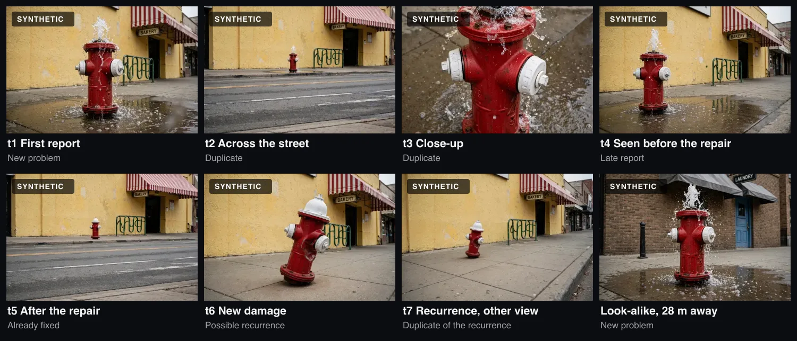

# CiviFold evaluation

How CiviFold's suggestions were measured, with every recorded run. The raw results are in [results/](results/). Each JSON file holds the per-case outcomes, the summary, and fingerprints of the code and prompts it ran with (`code_hash`, `prompt_hash`).

## Dataset

The dataset contains 504 synthetic images of 72 assets: 36 primary assets and 36 look-alikes, generated with Muse Image. It covers four categories: fire hydrants, street lights, dumped trash and road damage (18 assets each). The app also accepts traffic signs, benches and graffiti, but those are not evaluated. A look-alike is the same model of fixture with the same kind of damage, placed 25 to 30 m from its primary asset in different surroundings.

Every primary asset has a timeline. Each step is one report:



| Case | What the report shows | Expected suggestion |
|---|---|---|
| t1 | The first report | New problem |
| t2 | The same problem from across the street | Duplicate |
| t3 | A close-up of the same problem | Duplicate |
| t4 | The problem seen before the repair, sent after it | Late report |
| t5 | The fixture after the repair | Already fixed |
| t6 | A new problem after the repair | Possible recurrence |
| t7 | The recurrence from another view | Duplicate of the recurrence |
| look-alike | The look-alike, while the incident is open and after it is fixed | New problem |

Base sets also include a few time-conflict cases (the stated time contradicts the photo), close-up late reports and GPS-error cases. **Stress sets** repeat t2 and t6 at night or with a degraded photo: dark, blurred, low resolution, JPEG-compressed or off-center.

**Oracle incident state.** Each case is evaluated against the incident history its timeline says should exist at that moment: earlier reports linked to the right incident, the repair recorded, the recurrence opened. It is not an operational simulation in which an earlier wrong suggestion carries into the incident state for later reports.

**Simulated residents.** When CiviFold asks one question (a wider shot, another angle, a close-up, the time it was seen), the simulated resident answers with a matching dataset photo or fact that the report and the incident do not already have. "Left to staff if no resident answers" is the other bound.

## Outcomes

Each suggestion is classed against the expected label:

- **correct**: the right label and, where it links, the right incident.
- **deferred**: left to staff (`HUMAN_REVIEW`) or still waiting for the resident.
- **safe error**: wrong, but not a label that would let staff close the report. For example, "possible recurrence" for a report that is in fact already fixed.
- **critical**: a closing label (duplicate, late report, already fixed) on a report that needs attention (expected new problem or recurrence), or one that links to the wrong incident.

The headline number counts critical outcomes among the reports that need attention. "Correctly linked" is the share of all reports that were correctly suggested as a duplicate or late report.

## Process

- **dev** was used for tuning, and **val** only to check direction. **test** was the first unseen set, run once.
- **holdout** was created after the test run, while the rules were being improved from the test failures. It was pre-registered (cases and fingerprints recorded) before its run.
- **holdout2** was created and fingerprinted before the second round of rule changes, and pre-registered before its run. After it, the fast path (rules, triage, comparison and after-fix prompts, thresholds) was frozen.
- **holdout3** was created and locked after the verification agent was tuned on dev, before its run. Only the agent changed in that round.
- Holdout runs refuse to start without `HOLDOUT_FINAL_RUN=yes`, and holdout assets are excluded from the app.
- Each configuration's first evaluation on each set is a single run. Three re-measurements were made afterwards, and all are reported below: the 23 affected holdout2 cases after a harness fix, the agent configuration on holdout3 after removing meaningful identifiers, and the fast path on holdout3 a second time, live, to see model variance.
- Live runs used the Meta Model API. Replays of recorded calls cost nothing and give the same results.

## Configurations

| Config | What it decides from |
|---|---|
| `baseline_geo` | Distance and kind only: the nearest incident of the same kind within the search radius is suggested as a duplicate |
| `A_full_image` | The decision rules on whole-photo comparisons only |
| `B_sam_crops` | The decision rules on SAM cut-out comparisons only (the object and its surroundings) |
| `C_rules` | The fast path: the decision rules on both whole-photo and cut-out comparisons, plus the after-fix zoomed check. This is what the app runs |
| `D_hybrid` | C, plus the verification agent run automatically on every suggestion that would close a report; a run that does not finish sends the report to staff |

The app ran D_hybrid until the holdout3 results below. It now runs C, and staff can request the agent on a closing suggestion. That staff-requested mode is not what D_hybrid measures: there the agent runs on every closing suggestion without anyone asking, and an unfinished run turns the suggestion into staff review. A staff-requested run that cannot start leaves the suggestion as it is, and one that stops partway applies only what it found so far, so the suggestion can stay as it was. The staff-requested mode has not been evaluated.

A and B apply the same rules as C to a subset of its comparisons. They show what each kind of comparison contributes. They are not steps in a sequence where each addition improves the result.

## Results, base sets

Critical counts only the reports that need attention. Correct, deferred and linked are over all base reports.

**test**: 16 assets, 78 reports, 33 need attention. First run.

| Config | Critical | Correct | Deferred | Correctly linked | Left to staff, no answers |
|---|---|---|---|---|---|
| baseline_geo | 24 / 33 | 25 | 0 | 21.8% | 0% |
| A_full_image | 2 / 33 | 68 | 5 | 42.3% | 15.4% |
| B_sam_crops | 1 / 33 | 50 | 23 | 32.1% | 43.6% |
| C_rules | 1 / 33 | 69 | 3 | 42.3% | 17.9% |
| D_hybrid | 1 / 33 | 69 | 3 | 42.3% | 17.9% |

**holdout**: 8 assets, 39 reports, 16 need attention. First run.

| Config | Critical | Correct | Deferred | Correctly linked | Left to staff, no answers |
|---|---|---|---|---|---|
| baseline_geo | 11 / 16 | 14 | 0 | 23.1% | 0% |
| A_full_image | 2 / 16 | 32 | 5 | 35.9% | 64.1% |
| B_sam_crops | 2 / 16 | 25 | 11 | 33.3% | 43.6% |
| C_rules | 3 / 16 | 33 | 3 | 41.0% | 41.0% |
| D_hybrid | 3 / 16 | 33 | 3 | 41.0% | 41.0% |

test and holdout ran before two fixes to the simulated resident. The first fix came after the holdout run: in 85 of the 277 cases that existed then, the simulated answer was the same image as the report photo. One of the holdout's critical outcomes (S9-t6) was a result of it. The second fix came after holdout2: some answers reused a photo the report or incident already had (test 4 cases, holdout 7, holdout2 11). test and holdout were not re-run, so their correct counts may be higher than a fixed harness would give.

**holdout2**: 16 assets, 80 reports, 33 need attention. Original run, then C and D re-run on the 23 cases the second harness fix affected (`*_holdout2_20.json`), with the decision code unchanged.

| Config | Critical | Correct | Deferred | Correctly linked | Left to staff, no answers |
|---|---|---|---|---|---|
| baseline_geo | 22 / 33 | 28 | 0 | 22.5% | 0% |
| A_full_image | 1 / 33 | 70 | 5 | 42.5% | 60.0% |
| B_sam_crops | 0 / 33 | 60 | 10 | 38.8% | 28.7% |
| C_rules | 1 / 33 | 66 | 7 | 40.0% | 28.7% |
| D_hybrid | 1 / 33 | 63 | 10 | 36.3% | 31.3% |
| C_rules, after the harness fix | 1 / 33 | 65 | 8 | 38.8% | 28.7% |
| D_hybrid, after the harness fix | 1 / 33 | 62 | 11 | 35.0% | 31.3% |

The remaining miss (W12-t6) is three paint buckets dumped again by a wall, read as "already fixed". The cut-out-only configuration deferred it to staff, avoiding the wrong closing suggestion without classifying it as a recurrence.

In C_rules' original holdout2 run, the correct incident was in front of staff for 53 of the 56 reports about an existing incident:

| Outcome | Reports |
|---|---|
| Correct suggestion | 43 |
| Deferred, with the correct incident available as a candidate | 6 |
| Incorrect "possible recurrence" suggestion for the correct incident (three already fixed, one late report) | 4 |
| Missed: a large GPS error put the incident outside the search radius, so it was suggested as new | 2 |
| Critical (W12-t6, above) | 1 |

**holdout3**: 16 assets, 80 reports, 33 need attention. First run, a second live run of the fast path, and the agent configuration's re-run.

| Config | Critical | Correct | Deferred | Correctly linked | Left to staff, no answers |
|---|---|---|---|---|---|
| baseline_geo | 24 / 33 | 26 | 0 | 22.5% | 0% |
| A_full_image | not run | | | | |
| B_sam_crops | not run | | | | |
| C_rules | 0 / 33 | 72 | 3 | 42.5% | 31.3% |
| C_rules, run 2 (same code, live again) | 0 / 33 | 67 | 7 | 38.8% | 27.5% |
| D_hybrid, run 1 | 0 / 33 | 66 | 8 | 37.5% | 33.8% |
| D_hybrid, run 2 | 0 / 33 | 63 | 12 | 32.5% | 37.5% |

On holdout3, C asked the resident one question in 28.8% of reports, and its live run spent $0.053 per report (24 s). The agent added $0.025 per report in run 2; its fast-path calls were replayed from C's run.

**Model variance.** C_rules ran on holdout3 a second time on October 29, live, with its calls recorded in a separate cache folder so run 1 stays replayable (`C_rules_holdout3_2.json`). The rules, thresholds and the triage and comparison prompts were unchanged (their prompt hashes match run 1); the code fingerprint differs because agent-only files and comments changed in between. Run 2 made no critical error either, got 67 of 80 right (52 before any answer, against 51) and deferred 7, asked in 25.0% of reports and spent $0.051 per report (28 s). Five of the 112 cases changed, every one toward caution. On W16 (a torn sofa and cardboard boxes) and S16 (a streetlight) one cut-out comparison came back "different" where run 1 had said "uncertain", so R2v held the report for staff after the resident's answer instead of linking it (W16-t2, W16-t4, W16-gps-small, S16-t5). On W16-t5 the zoomed after-fix check found a problem run 1 had missed, so the suggestion was possible recurrence instead of already fixed. The stress set came out identical.

## Stress sets

Critical outcomes over all stress reports, first runs:

| Set | Reports | baseline_geo | A | B | C | D |
|---|---|---|---|---|---|---|
| test | 32 | 16 | 2 | 2 | 2 | 2 |
| holdout | 16 | 8 | 3 | 1 | 3 | 2 |
| holdout2 | 32 | 16 | 1 | 0 | 1 | 1 |
| holdout3 | 32 | 16 | not run | not run | 0 (both runs) | 0 (both runs) |

## The verification agent

In D_hybrid the agent runs whenever the fast path suggests a closing label. It has at most 8 tool calls, $0.20 and 120 s per run, and at most 2 runs per report. It can stop a suggestion but never make one less cautious. A run that does not finish leaves the report to staff.

- Across test, holdout and holdout2, it stopped one wrong suggestion (on the holdout stress set). Otherwise it added deferrals.
- Before holdout3, the agent's limits, closing behavior and prompt were strengthened. They were tuned on dev only.
- **Identifiers.** In the evaluation, identifiers carried meaning: images were named after their asset and state (`syn_H15_damaged_v2_front`), reports after their case type (`report:H15-t6`), and incidents after their asset (`H15/I1`). The agent saw these in its first message and in tool results. The fast path's vision models never received them: they see photos labelled "IMAGE N1" and "IMAGE C1". The agent now sees only neutral names (`photo_01`, `incident_01`, `report_01`), mapped back on the server.
- The same change removed the agent's `ask_resident` tool (questions come from the rules, and the agent had not used it on holdout3). It also corrected two prompt instructions that did not match the implementation.
- holdout3 was then re-measured (run 2). This is a re-measurement of the same holdout, not new unseen data. The difference from run 1 cannot be attributed to the identifiers alone, and with one run each, run-to-run variation is not separated.

| holdout3 | Run 1 (identifiers visible) | Run 2 (neutral names) |
|---|---|---|
| Agent runs | 53 | 53 |
| Proposed / blocked by guardrail / unfinished | 46 / 6 / 1 | 49 / 2 / 2 |
| Critical | 0 / 33 | 0 / 33 |
| Correct | 66 | 63 |
| Deferred | 8 | 12 |

In run 2, the two unfinished runs ended because the model answered without calling a tool twice in a row. The safety rule sent both reports to staff. On holdout3 the agent did not reduce critical errors, since the fast path already had none, and it increased deferrals.

## Running the evaluation

These commands evaluate the current code. They do not reproduce historical runs made with earlier code or prompts, and the model cache those runs used is not in the repository, so they need a Meta Model API key. `--run` defaults to 1, which is the number of the published results. Pass a new number so they are not overwritten.

```bash
npm run eval -- --config C_rules --split dev --run 100      # baseline_geo | A_full_image | B_sam_crops | C_rules | D_hybrid
npm run summarize-eval -- --split dev
HOLDOUT_FINAL_RUN=yes npm run eval -- --config C_rules --split holdout3 --run 100
```

A repeat run of the same code measures model variance only if its calls are live: the cache replays the first run otherwise. Point it at its own cache folder so the first run stays replayable:

```bash
HOLDOUT_FINAL_RUN=yes CIVIFOLD_CACHE_DIR=.cache/llm-holdout3-run2 npm run eval -- --config C_rules --split holdout3 --run 2
```

Run the full set (the default, `--set all`). A run with `--set base` or `--set stress` writes only that set into its result file, replacing what was there. `--only` re-runs the listed cases into an existing result file and keeps its other cases (with no file yet, it writes only the listed cases); the file's code and prompt fingerprints then describe the latest run, not the kept cases.
